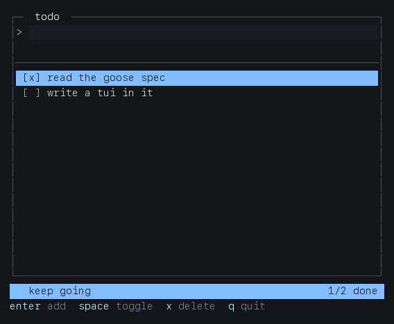

# goose-tui

A terminal UI framework written in [Goose](https://github.com/aardappel/goose) —
the memory-safe systems language with no heap, no GC and no lifetime
annotations. (The Goose *language*: Block's goose AI agent is an unrelated
project with the same name.)

Immediate-mode widgets over a diffed cell grid. Your state is a struct on the
stack; a frame is a sequence of function calls; the presenter writes only the
cells that changed.

Pre-1.0: the API is still moving. Pin a tag (or a commit) if you need a fixed
target.



## Requirements

- [Goose](https://github.com/aardappel/goose/releases) v2026.3 or later on
  `PATH`. Unpack a release anywhere; it finds its standard library and
  packages beside itself.
- A C compiler for `goose build` (`cc`, `gcc` or `clang`; `goose toolchain`
  reports which). `goose run` also needs the platform's C headers: the Xcode
  command line tools on macOS, `libc6-dev` / `glibc-devel` on Linux.
- macOS 13.3+ or Linux with glibc 2.35+ (Ubuntu 22.04, Debian 12). POSIX
  only; Windows is not supported — [`docs/platforms.md`](docs/platforms.md)
  says why, and what a port would cost.
- `sh` and `python3` for the full test suite.

```goose
import std;
import tui from "you/goose-tui@v0.1.0";   // or a checkout: "../goose-tui"

fn main() {
    var t = tui::term();
    if !tui::open(t) { return; }             // raw mode, alternate screen
    var app = tui::app();
    var c = tui::canvas(t.w, t.h);

    tui::run(app, t, c) { cv, ev =>
        if tui::key_is(ev, 'q') { tui::quit(app); }
        tui::panel(cv, tui::rect(0, 0, cv.w, cv.h), "hello", app.theme);
    };
    tui::close(t);
}
```

## What it does

- **Six C functions** (`open`, `close`, `size`, `read`, `write`, `mouse`) in
  `src/term.c`; everything else — ~2 300 lines of layout, widgets, UTF-8, key
  decoding and diffing — is Goose.
- **Cell-level diffing.** An idle frame writes **0 bytes**. A keystroke writes
  tens, not thousands (measured in `tests/diff.goose`).
- **Wide glyphs and combining marks** handled in the buffer: `中` claims two
  cells, its tail is a marker, and overwriting either half repairs both.
- **A real decoder**: CSI/SS3 arrows, modifiers, `CSI u`, SGR mouse, bracketed
  paste (chunked), resize, and a lone `ESC` resolved by a 25 ms timeout.
- **Immediate-mode widgets**: `panel`, `para`, `ellipsis`, `list`, `table`,
  `tabs`, `input` (with a caret), `gauge`, `spark`, `scrollbar`, `log_view`,
  `status`, `help`, `focus`, plus the drawing primitives they are built from.
- **Four themes** as flat structs you can copy and edit: `dark`, `light`,
  `mono`, `nord`.
- **Testable without a terminal**: golden screens via `tui::screen_text`, diff
  bytes via `tui::present`, keystrokes via `tui::headless`, and a pty test that
  checks the real terminal lifecycle.

## Layout

```
tui.goose        terminal, App, run loop, headless driver
cell.goose       Cell, Style, Canvas, drawing, the diffing presenter
rect.goose       Rect arithmetic: splits, rows, columns, centring
utf8.goose       decoding, code-point walking, display width
keys.goose       Key/Event, the byte-stream decoder, event helpers
theme.goose      Theme struct, four themes, Style accessors
widgets.goose    every widget, and the key handler that goes with it
src/term.c       the only platform code
examples/        7 runnable programs, each with `--dump`
tests/           4 Goose suites + a pty test + run.sh
docs/            DESIGN.md (why), guide.md (how), reference.md (what),
                 platforms.md (where), demo.gif
.github/         CI: Goose v2026.3 on macOS and Linux, `sh tests/run.sh`
LICENSE          Apache-2.0 (see also NOTICE, CHANGELOG.md, CONTRIBUTING.md)
```

## Run the examples

```sh
cd examples
goose run 01_hello.goose              # interactive
goose run 01_hello.goose -- --dump    # one frame as text, no terminal needed
goose run 05_todo.goose -- --keys "jjx" --dump
```

Every example shares `examples/_harness.goose`, which adds `--dump`,
`--keys`, `--frames`, `--cols` and `--rows`. When stdin is not a terminal it
dumps automatically, so the examples double as fixtures.

| example | what it shows |
|---|---|
| `01_hello` | the smallest complete program: a panel, centred text, one key |
| `02_events` | every event the decoder produces, drawn as it arrives |
| `03_layout` | `split_h`/`split_v`/`row_at` building a three-pane screen |
| `04_widgets` | the widget gallery: list, table, tabs, input, gauge, spark, scrollbar |
| `05_todo` | a real editor: add, toggle, delete, scroll, a status bar |
| `06_dashboard` | animated metrics: gauges and sparklines on a clock |
| `07_theme` | switching themes at runtime, truecolor vs 256 vs mono |

## Build and test

```sh
sh tests/run.sh          # typecheck, 4 suites, every example headless, pty
sh tests/run.sh --quick  # skip the example builds and the pty
```

The package is used by path or by a pinned git ref; there is no registry step:

```goose
import tui from "you/goose-tui@v0.1.0";   // a tag, a commit or a branch
import tui from "../goose-tui";           // a checkout, used in place
```

`goose build` writes the binary beside the source. CI runs `sh tests/run.sh`
on macOS and Linux with Goose v2026.3 (see `.github/workflows/ci.yml`).

## Portability

POSIX only — macOS and Linux share the same `src/term.c`. Windows is out of
scope: it needs a different console API, and pretending otherwise would mean a
second platform layer pretending to be one.

[`docs/platforms.md`](docs/platforms.md) is the report: the escape sequences a
terminal must implement, the hosts that are tested and the ones that are only
expected to work, and what a Win32 backend would cost (six calls, roughly
250–450 lines, and the `INPUT_RECORD` translation for anything older than
Windows 10 1809).

## Design

`docs/DESIGN.md` argues the choices: why immediate mode and not a widget tree,
why one flat cell array and one diff, why the C boundary is exactly six
functions, and what each rejected alternative would have cost.

## Contributing

[`CONTRIBUTING.md`](CONTRIBUTING.md) has the setup, the six rules a change has
to keep, and what a new widget needs: drawing, a golden test, a reference
entry, an example.

## License

Apache License, Version 2.0 — see [`LICENSE`](LICENSE). Copyright 2026 The
goose-tui authors; see [`NOTICE`](NOTICE) for attribution.

goose-tui is an independent project: it is not part of the Goose distribution
and is not affiliated with its authors. Goose itself is Apache-2.0.
